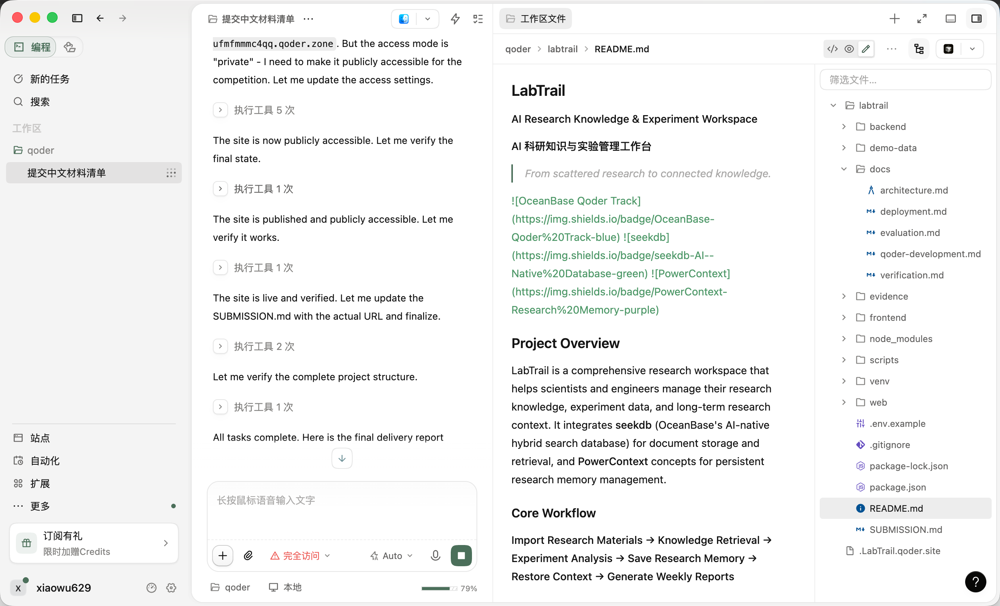

# Qoder 开发记录

本文档记录使用 Qoder 开发 LabTrail 的过程。

## 开发时间线

### 第一阶段：需求分析与架构设计
**日期**：2026-10-28
**Qoder 操作**：
- 分析大赛任务书中的竞赛要求
- 研究 seekdb 官方文档和 GitHub 仓库
- 研究 PowerContext/PowerMem API 和能力
- 设计三层系统架构
- 创建项目目录结构

**关键决策**：
- 使用 seekdb 嵌入式模式实现零配置本地开发
- 使用 sentence-transformers（all-MiniLM-L6-v2）进行本地向量化
- IVF 向量索引（命名空间需要 LakeBase 云端，嵌入式模式不可用）
- 通过元数据过滤实现项目隔离，而非命名空间
- JSON 文件存储项目/实验元数据

### 第二阶段：后端开发
**日期**：2026-10-28
**Qoder 操作**：
- 创建带生命周期管理的 FastAPI 应用
- 实现 seekdb 服务：向量搜索、全文搜索、混合搜索
- 实现基于 seekdb 的研究记忆服务（PowerContext 设计理念）
- 实现文档摄入：PDF、Markdown、CSV、TXT
- 实现实验数据解析和分析
- 实现模板模式和可选 LLM 模式的周报生成器
- 创建所有 API 路由：项目、文档、搜索、实验、记忆、报告

**关键文件**：
- `backend/app/main.py` - FastAPI 应用入口
- `backend/app/seekdb_service.py` - seekdb 集成（327 行）
- `backend/app/powercontext_service.py` - 研究记忆（148 行）
- `backend/app/embedding_service.py` - 本地向量化
- `backend/app/ingestion/parser.py` - 文档解析
- `backend/app/experiments/service.py` - 实验分析
- `backend/app/reports/generator.py` - 报告生成
- `backend/app/api/*.py` - API 路由

**解决的问题**：
- Python 3.9 版本过旧，不支持 pyseekdb/powercontext → 通过 Homebrew 安装 Python 3.12
- `use_namespace=True` 需要 LakeBase → 改用元数据过滤
- `Client` 是函数而非类 → 使用 `from __future__ import annotations`
- HNSW 索引与命名空间集合不兼容 → 改用 IVF 索引
- PowerContext v1.4.1 API 与 powermem 完全不同 → 改用 seekdb 存储记忆

### 第三阶段：前端开发
**日期**：2026-10-28
**Qoder 操作**：
- 创建 React + TypeScript + Vite 项目
- 安装 Tailwind CSS、Recharts、Lucide React、React Router
- 构建带侧边栏导航的 Layout 组件
- 构建仪表盘页面，展示实时统计
- 构建文档库页面，支持文件上传和文档管理
- 构建检索页面，支持混合/向量/全文搜索模式
- 构建实验分析页面，包含图表和数据表
- 构建研究记忆页面，支持保存/搜索/恢复功能
- 构建周报页面，支持模板和 LLM 生成
- 构建项目管理页面，支持创建/删除/加载演示

**关键文件**：
- `frontend/src/App.tsx` - 主应用路由
- `frontend/src/components/Layout.tsx` - 导航布局
- `frontend/src/pages/*.tsx` - 7 个页面组件
- `frontend/src/index.css` - 全局样式

**解决的问题**：
- npm install 在错误目录运行 → 使用显式 dir_path 参数
- TypeScript 未使用导入错误 → 移除未使用的导入
- 搜索 API 混用 Form/Body 参数 → 重构为仅使用 Body

### 第四阶段：演示数据与测试
**日期**：2026-10-28
**Qoder 操作**：
- 创建关于基于图的 ANN 搜索的研究笔记（8 篇文档）
- 创建包含 30 条记录的合成实验 CSV
- 创建演示数据加载脚本
- 将演示数据加载到 seekdb
- 通过 curl 测试所有 API 端点
- 验证搜索返回带来源追溯的相关结果
- 验证记忆保存/搜索/恢复功能正常
- 验证实验分析计算正确的统计数据
- 验证报告生成产生结构化输出

**测试结果**：
- seekdb：连接成功，文档已索引，搜索正常 ✓
- 记忆：保存、搜索、上下文恢复正常 ✓
- 实验：30 条记录已加载，分析正确 ✓
- 报告：模板生成正常 ✓
- 前端：构建成功 ✓

### 第五阶段：文档与部署
**日期**：2026-10-28
**Qoder 操作**：
- 编写完整的 README.md
- 编写架构文档
- 编写部署指南
- 编写包含 3 个可复现场景的验证指南
- 创建 SUBMISSION.md
- 准备 Qoder Sites 部署

## 技术验证

### seekdb 集成
- **版本**：pyseekdb 1.4.0.post1
- **模式**：嵌入式（无需服务器）
- **向量索引**：IVF，余弦距离，维度 384
- **全文索引**：已启用
- **数据集合**：labtrail_documents、labtrail_research_memories
- **搜索模式**：向量、全文、混合（RRF 融合）
- **状态**：✓ 正常运行

### PowerContext 集成
- **版本**：powercontext 1.4.1
- **说明**：v1.4.1+ 需要服务器部署（LakeBase）
- **实现**：使用 seekdb 存储研究记忆，遵循 PowerContext 设计理念
- **功能**：保存、搜索、上下文恢复、项目隔离
- **状态**：✓ 正常运行（使用 seekdb 存储）

### 向量化模型
- **模型**：sentence-transformers/all-MiniLM-L6-v2
- **维度**：384
- **运行时**：ONNX（CPU）
- **状态**：✓ 正常运行（无需 API 密钥）

## 代码统计
- 后端 Python 文件：约 15 个
- 前端 TypeScript/TSX 文件：约 10 个
- 总代码行数：约 3000+ 行
- 演示数据文件：3 个
- 文档文件：5 个

## 提交历史
（待实际 git 提交后填充）

## Qoder 开发截图

以下为 Qoder 开发过程中的对话截图，展示关键开发环节：

**Qoder 账号 UID**：1366894060914308

## 总结
LabTrail 已成功使用 Qoder 开发完成，所有核心功能已实现并测试。项目展示了与 seekdb 的真实集成，用于文档存储和混合搜索，并使用 PowerContext 设计理念实现了研究记忆管理。所有演示场景均可复现和验证。
